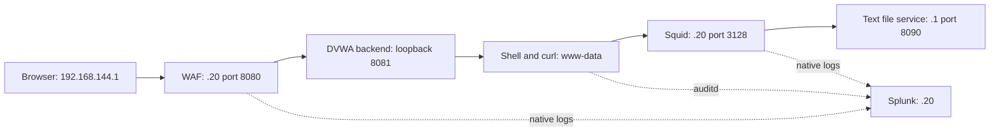

# Web Application Command Injection Investigation

A SOC investigation of a command injection attempt against a deliberately vulnerable ping form. I followed the request through a WAF, the web server's processes and an outbound proxy, then compared detection with prevention.

In DetectionOnly mode, the injected command ran as `www-data` and downloaded one harmless text file through Squid. After enabling blocking, the **identical input** returned 403 and produced no backend POST, web process, proxy request or new download during the observed window. A normal ping still worked.

## Cases

| Case | Observed result |
| --- | --- |
| Normal ping | HTTP 200; expected shell and ping processes. |
| Command execution | `/usr/bin/id` triggered CRS rule 932160 but still executed in DetectionOnly mode. |
| Internal text download | WAF request linked to Apache, shell, curl, Squid, the file server request and a matching file hash. |
| Prevention comparison | Same download input blocked; normal ping remained available. |

An additional calibration input using the short command `id` executed without an RCE warning. This is a coverage limitation, not evidence that every injected command was detected. One earlier compressed-response audit record also had invalid JSON encoding; its original bytes are preserved and the gap is documented.

## Environment

Ubuntu 24.04, DVWA, Apache, ModSecurity 2.9.7 with OWASP CRS 3.3.5, auditd, Squid 6.14 and Splunk Enterprise 9.4.1. All activity stayed inside a private VMware lab. WAF, backend, proxy and Splunk were separate services on the same Linux VM; they were not separate security boundaries.

## Investigation and evidence

- [Investigation and timeline](docs/investigation.md)
- [Lab configuration and manual reproduction](docs/lab-and-reproduction.md)
- [Six simple searches and their verified results](docs/search-guide.md)
- [Evidence provenance and limitations](docs/evidence-guide.md)
- [Dashboard source](dashboard/web-investigation.xml)
- [Verified dashboard screenshot](images/16-dashboard.jpg)
- [Native evidence](evidence/native/) and [file hashes](evidence/SHA256SUMS.json)

The scheduled alert was configured before the command attempts. It fired at **22:56:00 UTC on 28 October 2026**, with two results. Its schedule was stopped after validation while retaining trigger history. No email or webhook action was used.

The downloaded file was plain text, 85 bytes, SHA-256 `2cb5d2a756e4ecf603f4c3bc8c82fa4a5df50aa1f0fbad3920b35e9d72d6e398`. It was not executed. The investigation does not demonstrate malware, persistence, credential theft or public command-and-control traffic.

The project practices web attack triage, WAF actions, process correlation, proxy fields, scope and evidence-based conclusions. The small product-specific addition is understanding the CRS rule and the log fields used here.

The repository URL retains its earlier name. Its current content is this command injection investigation; the previous beaconing lab remains in Git history.
