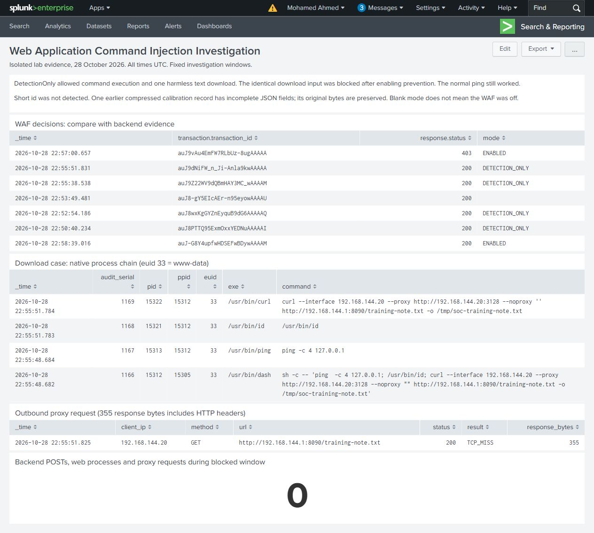
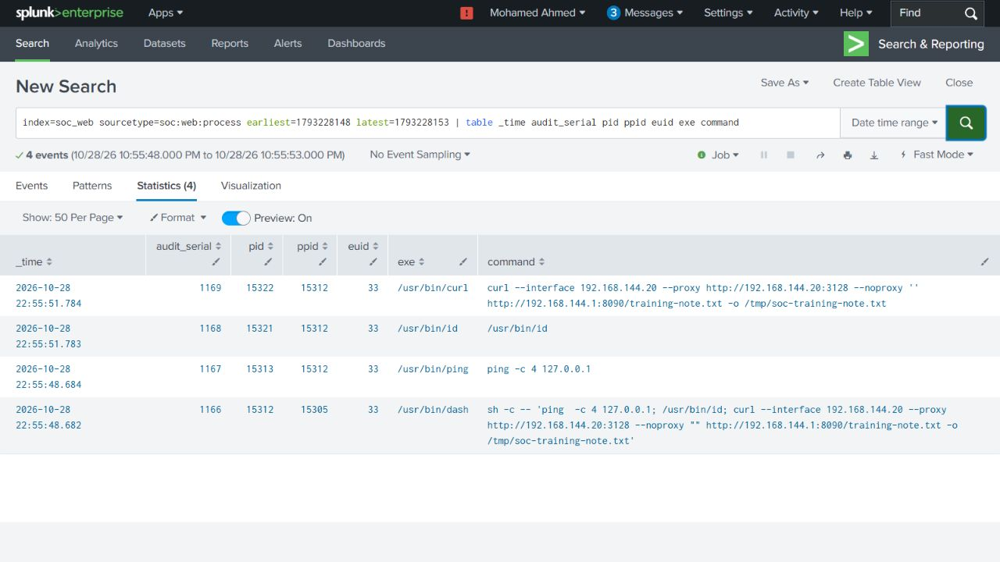
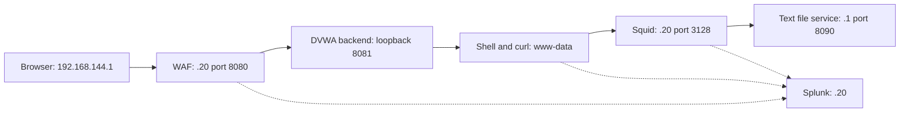
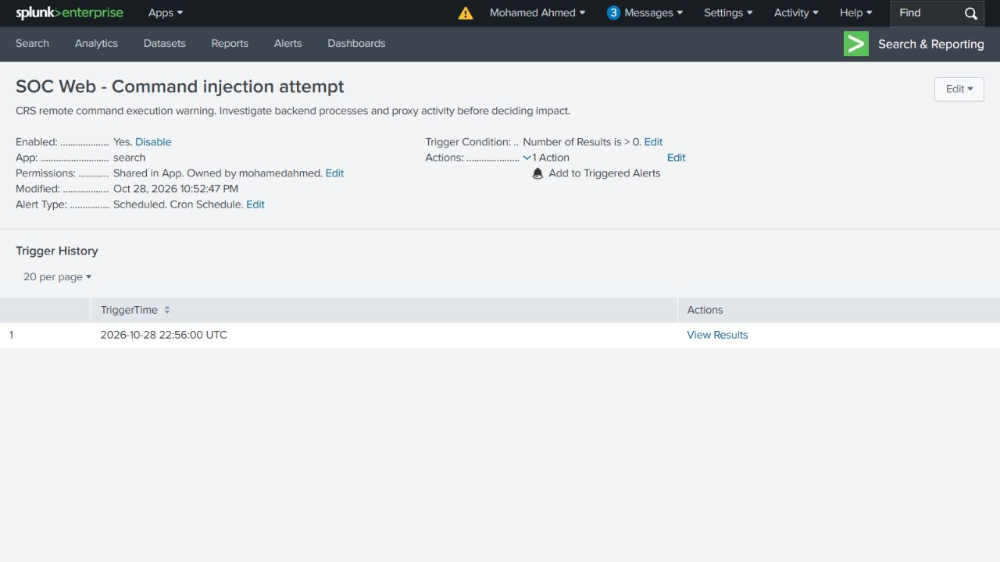

# Web Application Command Injection Investigation

Investigated a command injection attempt against a vulnerable web form using WAF alerts, Linux process records and outbound proxy logs in Splunk.

**Outcome:** the allowed request executed as `www-data` and downloaded an internal text file through Squid. Enabling WAF blocking stopped the identical request, while a normal ping continued to work.

## Cases and findings

| Case | Finding |
| --- | --- |
| Normal ping | The request reached DVWA and started the expected shell and ping processes. |
| Command execution | `/usr/bin/id` matched CRS rule 932160 and executed while the WAF was in DetectionOnly mode. |
| Internal download | The WAF request, Apache worker, shell, curl, proxy request and downloaded file formed one evidence chain. |
| Blocking comparison | The same input returned 403, with no observed backend POST, web process, proxy request or new download in the comparison window. Normal ping still worked. |

## Investigation

The starting question was whether the WAF had recorded an attempt or whether the server had actually executed it. I followed the request identifier into the backend log, linked the Apache worker to its child processes, and checked the outbound URL and downloaded file.

The saved file is 85 bytes of plain text. Its SHA-256 matches the served file. It was downloaded, not executed. The [walkthrough](docs/investigation.md) shows each stage and the evidence used to reach that conclusion.

## Environment

Ubuntu 24.04, DVWA, Apache, ModSecurity 2.9.7 with OWASP CRS 3.3.5, auditd, Squid 6.14 and Splunk Enterprise 9.4.1 in a private VMware lab. WAF, backend, proxy and Splunk run as services on the same Linux VM. The browser and internal file service are on the Windows host.

## Tested alert

The scheduled command-injection alert was configured before the command tests. It triggered at **22:56:00 UTC on 28 October 2026** with two results. Scheduling was stopped after validation and the trigger history was retained.

## Project files

- [Investigation and timeline](docs/investigation.md)
- [Six searches, explanations and result screenshots](docs/search-guide.md)
- [Lab configuration and reproduction](docs/lab-and-reproduction.md)
- [Native evidence and scope](docs/evidence-guide.md)
- [Dashboard source](dashboard/web-investigation.xml)
- [Original logs and file proof](evidence/native/) and [evidence hashes](evidence/SHA256SUMS.json)

The [evidence guide](docs/evidence-guide.md) records the short-command coverage gap and one preserved calibration record with invalid encoding. The performed response was WAF blocking; application code remediation is a separate recommendation.
