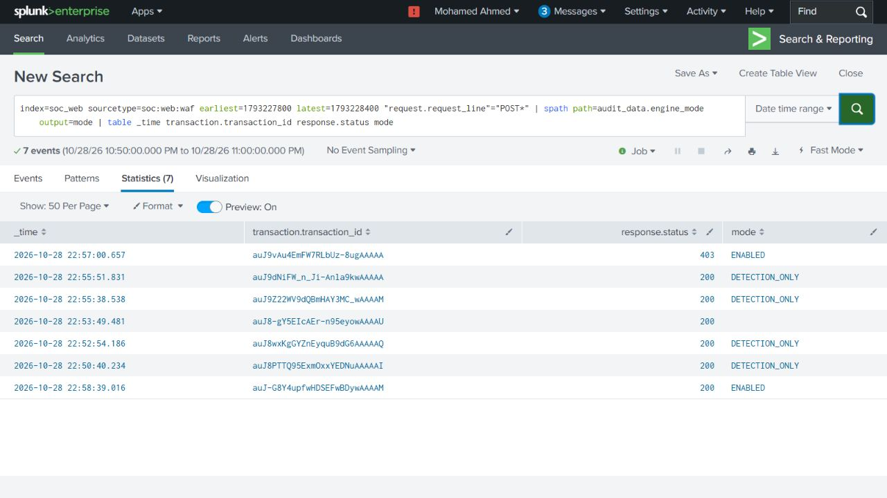
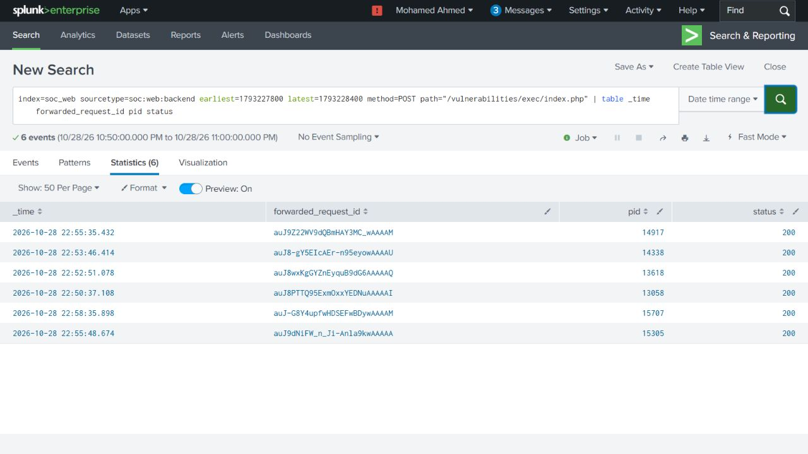
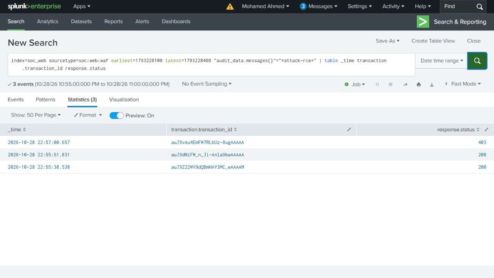
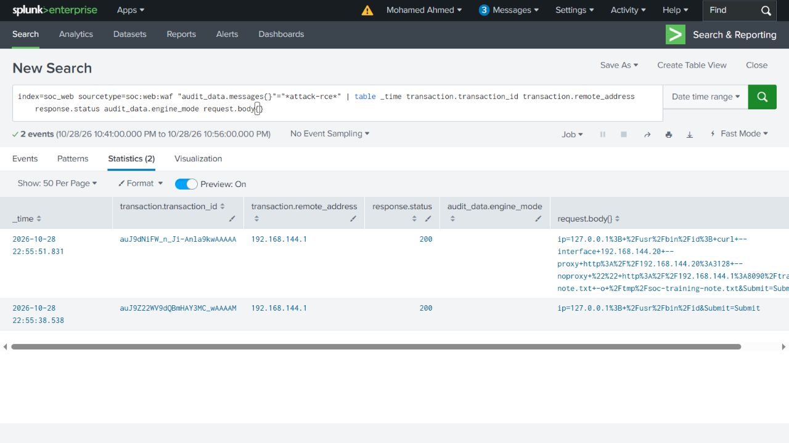

# Search guide

Each search answers one investigation question. The six searches were run in Splunk Search & Reporting and their saved results were checked against the native logs. The original job IDs and query text remain in [UI-validation.json](../searches/UI-validation.json).

## Recorded time windows

All dates below are **28 October 2026, UTC**. The SPL uses epoch values to preserve those exact windows. `earliest` includes its boundary; `latest` excludes it.

| Searches | UTC window | Purpose |
| --- | --- | --- |
| 01, 02, 04 | 22:50:00–23:00:00 | Overview of the submitted cases. |
| 03 | 22:55:48–22:55:53 | Shell and child processes for the download. |
| 05 | 22:57:00–22:58:19 | Side effects during the blocked comparison. |
| 06 | 22:55:00–23:00:00 | Later RCE warnings. |

For another execution, use its own recorded times. A zero-result check needs its bounded observation window; All time would answer a different question.

## What happened to each submitted request?

The search selects POST requests in the investigation window. `spath` reads the nested engine-mode value into the shorter `mode` field; `table` selects the displayed columns.

```spl
index=soc_web sourcetype=soc:web:waf earliest=1793227800 latest=1793228400 "request.request_line"="POST*"
| spath path=audit_data.engine_mode output=mode
| table _time transaction.transaction_id response.status mode
```

**Result:** 7 POST rows: one blocked request and the normal/allowed requests, including the earlier calibration record. The calibration row has a blank parsed mode; its original encoding issue is explained in the evidence guide.

[Search file](../searches/01-waf-decisions.spl) · [Original result](../searches/results/01-waf-decisions.json)



## Which requests reached the backend?

Select POSTs to the command page, then compare `forwarded_request_id` with the WAF transaction ID. `pid` identifies the Apache worker that handled the request.

```spl
index=soc_web sourcetype=soc:web:backend earliest=1793227800 latest=1793228400 method=POST path="/vulnerabilities/exec/index.php"
| table _time forwarded_request_id pid status
```

**Result:** 6 POST rows. The allowed download reached worker 15305. The blocked request ID is absent.

[Search file](../searches/02-backend-requests.spl) · [Original result](../searches/results/02-backend-requests.json)



## What ran during the download?

Use the narrow download window to view the native process records. PID identifies a process; PPID links it to its parent. Effective UID 33 is www-data. `audit_serial` points back to the original auditd event.

```spl
index=soc_web sourcetype=soc:web:process earliest=1793228148 latest=1793228153
| table _time audit_serial pid ppid euid exe command
```

**Result:** 4 rows: shell, ping, id and curl. Shell PID 15312 has parent 15305; curl PID 15322 has parent 15312.

[Search file](../searches/03-download-processes.spl) · [Original result](../searches/results/03-download-processes.json)


## Did the server use the proxy?

Show the proxy source, method, URL and response. Compare the URL and time with curl arguments and the independent file-service log.

```spl
index=soc_web sourcetype=soc:web:proxy earliest=1793227800 latest=1793228400
| table _time client_ip method url status result response_bytes
```

**Result:** 1 GET from .20, status 200 and TCP_MISS. The 355 response bytes include headers; the saved text file is 85 bytes.

[Search file](../searches/04-proxy-download.spl) · [Original result](../searches/results/04-proxy-download.json)


## Were execution or outbound effects observed after blocking?

The grouped condition selects three kinds of side effect: monitored process execution, proxy requests, or backend POSTs. `stats count` counts their combined matches. Normal backend OPTIONS traffic is outside this check.

```spl
index=soc_web earliest=1793228220 latest=1793228299 (sourcetype=soc:web:process OR sourcetype=soc:web:proxy OR (sourcetype=soc:web:backend method=POST))
| stats count
```

**Result:** One statistics row with count=0. That means zero matching events, not one side-effect event. The file/origin checks are retained separately in the before/after evidence.

[Search file](../searches/05-blocked-window.spl) · [Original result](../searches/results/05-blocked-window.json)


## Which later requests matched RCE warnings?

Search the WAF messages field for the attack-rce tag. Searching the same word anywhere in the raw event would also match rule metadata, so this search stays on the actual messages.

```spl
index=soc_web sourcetype=soc:web:waf earliest=1793228100 latest=1793228400 "audit_data.messages{}"="*attack-rce*"
| table _time transaction.transaction_id response.status
```

**Result:** 3 rows: the later full-path identity request, the allowed download and its blocked repeat. This is an investigation search; the actual earlier scheduled alert returned two results before the blocked repeat.

[Search file](../searches/06-rce-warnings.spl) · [Original result](../searches/results/06-rce-warnings.json)



## Scheduled alert

**SOC Web - Command injection attempt** ran every minute over the previous 15 minutes, triggered when the result count was greater than zero, and used 900-second suppression. Its only action was Add to Triggered Alerts. The [settings before validation](../evidence/alert-settings-before.json) and [after stopping scheduling](../evidence/alert-settings-stopped.json) preserve the actual configuration.

It was saved at 22:52:47 and its scheduled job fired at **22:56:00 UTC** with **two results**: the later identity request and download request. Job ID: `scheduler__mohamedahmed__search__RMD56017a17fbf3872ba_at_1793228160_4`.




The [original export](../evidence/scheduled-alert-results.json) has no populated engine-mode values, although the native WAF records contain DetectionOnly. Search 01 explicitly extracts that nested field with `spath`. The saved alert export and screenshot retain their original values.

The schedule was stopped after validation, with the alert still enabled so its trigger history was retained. Search 06 is a separate later investigation view; it is not a replacement for proof of the scheduled trigger.

## Dashboard

The [dashboard source](../dashboard/web-investigation.xml) combines WAF decisions, the download process chain, the proxy request and the blocked-window count using the same recorded windows.


